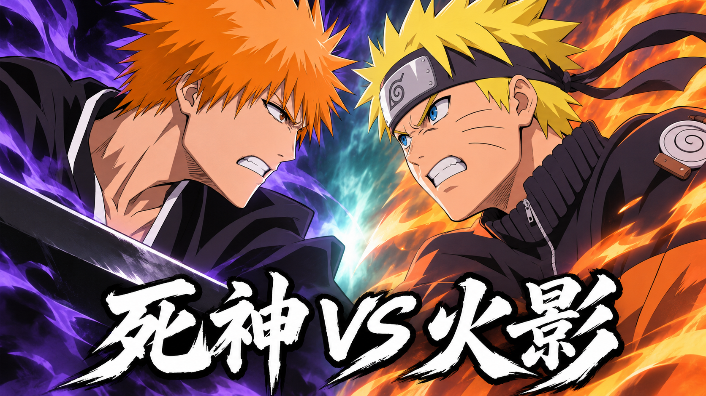

# PSP 上的 4399

Flash 游戏的非官方 PSP 移植项目，支持单人游玩，部分游戏支持两台 PSP 通过 WLAN 联机。

## 游戏下载

Release 附件仅提供各游戏的独立安装包。

| 游戏 | 安装包 |
| --- | --- |
| 森林冰火人：森林神殿 | [构建 11 优化版](https://github.com/Sumo1311/4399-on-PSP/releases/download/v2026.11.13/ForestTemple_PSP-build11.zip) |
| 勇者之路：精灵物语 | [1.0.1 优化版](https://github.com/Sumo1311/4399-on-PSP/releases/download/v2026.11.13/ElfStory_PSP-1.0.1.zip) |
| 双人旋转赛车 · Flipside | [1.0.3 优化版](https://github.com/Sumo1311/4399-on-PSP/releases/download/v2026.11.13/Flipside_PSP-1.0.3.zip) |
| 火柴人羽毛球 2 | [1.0.18 优化版](https://github.com/Sumo1311/4399-on-PSP/releases/download/v2026.11.13/Badminton2_PSP-1.0.18.zip) |
| 死神 vs 火影 3.7 Alpha（5DPLAY） | [1.0.0 封面背景更新版](https://github.com/Sumo1311/4399-on-PSP/releases/download/bvn37-v1.0.0/BVN37_PSP_1.0.0_Install.zip) |

## 安装

1. 解压安装包，将 `PSP` 文件夹合并复制到记忆棒根目录。
2. 确认路径为 `PSP/GAME/游戏目录/EBOOT.PBP`，从“游戏 → Memory Stick”启动。PSP 系统需支持运行自制程序。
3. 更新前备份个人存档。联机时，两台 PSP 使用相同版本并开启 WLAN。

PPSSPP 可直接打开游戏目录内的 `EBOOT.PBP`。

四款优化版采用 2026-11-11 的定版构建。《死神 vs 火影》包含 76 个可选形态、42 名援助、19 张场景，默认简体中文，按约定排除观战模式，并已嵌入配套封面与菜单背景。实体 PSP 持续性能和双机 WLAN 仍需分别验证。

## 源码与构建资料

- [死神 vs 火影原生源码、封面背景与重建说明](source/bvn37)
- [四款优化版的构建与重新链接资料](materials)
- [版本清单与 SHA-256](manifests)

## 协议与声明

本项目以非商业的学习、技术研究与交流为目的。原游戏素材、名称、角色与商标权利归各自权利人所有。

原创移植实现、工具和文档按 [MIT 协议](LICENSE) 提供；死神 vs 火影源码按其目录内 GPL-3.0 文本及各文件声明执行。原作素材及第三方依赖保留各自权利和许可证。详见 [协议范围](LICENSE_SCOPE.md)、[第三方声明](THIRD_PARTY_NOTICES.md)及 [重新链接说明](RELINKING.md)。如需核实相关内容，可通过 [Issues](https://github.com/Sumo1311/4399-on-PSP/issues) 联系。
